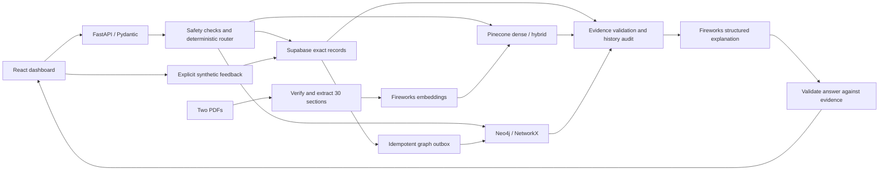

# LineMedic AI

Evidence-grounded troubleshooting for a **synthetic pharmaceutical filling and packaging line**.
LineMedic demonstrates how structured records, manual retrieval and graph relationships
can support traceable answers, recorded outcomes and comparative RAG evaluation.

> Demonstration only. All equipment, alarms, manuals and observations are fictional.
> This is not a validated GxP application, manufacturer guidance or authorization
> to maintain equipment. The role selector is demo functionality, not user authentication.

## Capabilities

- React and TypeScript dashboard with operator, technician and supervisor views.
- Deterministic routing to exact SQL, dense, hybrid, graph or combined retrieval.
- Fireworks structured explanations checked against retrieved fix, part and source IDs.
- Neo4j relationship retrieval with an explicitly labeled NetworkX fallback.
- Interactive Graph Atlas with SQL-audited history, exact PDF links and investigation handoff.
- Supabase feedback transactions, idempotent event handling and a durable graph outbox.
- Two synthetic PDF compilations, real text extraction, section chunking and physical-page citations.
- Frozen 30-question evaluation across four retrieval modes, with raw results and optional LangSmith traces.

## Architecture



The model does not execute unrestricted SQL or Cypher. Python selects the tools
and validates the answer. Manual text is treated as untrusted data. Unsafe requests,
unknown context, missing evidence and invalid model responses fail closed.

## Quick start

Requirements: Python 3.11+ and Node.js compatible with the pinned frontend toolchain
(verified locally with Python 3.13.5 and Node 24.11.0).

From the repository root in PowerShell:

```powershell
py -3.13 -m venv .venv-graph
.\.venv-graph\Scripts\python.exe -m pip install -r requirements.txt
Copy-Item .env.example .env
# Fill the integration settings in your local .env; do not commit it.
npm.cmd --prefix web ci
npm.cmd --prefix web run build
.\.venv-graph\Scripts\python.exe -m uvicorn src.api:app --host 127.0.0.1 --port 8765
```

For an existing checkout, reuse the environment and keep an already configured
`.env` rather than replacing it. Open <http://127.0.0.1:8765>. The manual library
and saved evaluation comparison work offline. Click **Connect live services**
to investigate; connection seeds the synthetic baseline idempotently and preserves feedback.

For frontend development, keep the API on 8765 and run
`npm.cmd --prefix web run dev`; Vite serves port 5173 and proxies `/api` to Python.
The alternative Streamlit entry point remains available with
`.\.venv-graph\Scripts\python.exe -m streamlit run app.py`.

## Configuration

Copy variable names from `.env.example`; put actual credentials only in local
`.env` or the host's secret environment variables.

| Integration | Required settings |
| --- | --- |
| Fireworks explanation | `FIREWORKS_API_KEY`, `FIREWORKS_MODEL` |
| Fireworks embeddings | `FIREWORKS_EMBEDDING_MODEL` |
| Pinecone | `PINECONE_API_KEY`, `PINECONE_INDEX_NAME` |
| Neo4j | `NEO4J_URI`, `NEO4J_USERNAME`, `NEO4J_PASSWORD`, `NEO4J_DATABASE` |
| Supabase | `SUPABASE_URL`, `SUPABASE_SERVICE_ROLE_KEY` |
| PDF-backed retrieval | `LINEMEDIC_PDF_MANIFEST=output/pdf/manifest.json` |
| Optional evaluation tracing | `LANGSMITH_API_KEY`, `LANGSMITH_PROJECT`, `LANGSMITH_TRACING` |

Use a dedicated synthetic Supabase project. Apply
[`001_synthetic_feedback.sql`](supabase/migrations/001_synthetic_feedback.sql)
in its SQL Editor. The adapter requires a backend secret/service-role key;
a publishable or anonymous key cannot access the server-only functions.

The existing live index and accessible models must be verified for your account;
the application does not invent API compatibility or provider results. See the
[learning guide](docs/LEARNING_GUIDE.md) for the previously verified settings.

## Synthetic dataset and provenance

The fixed seed is `20261018`. Baseline groups contain 3 lines, 10 equipment records,
20 alarms, 15 failure modes, 25 fixes, 20 parts, 50 work orders and 30 manual sections.
Evaluation questions are frozen independently of model outputs.

The 30 manual sections span five logical document IDs and exactly two generated
PDF compilations (18 and 12 physical pages). The manifest preserves both logical
and physical page references with file hashes. Parsing extracts actual PDF text;
it rejects altered content, active PDF features and invalid provenance before indexing.
The indexed corpus contains 30 manual sections and 50 baseline work orders.
PDF metadata links evidence to equipment, alarms, failures, fixes and parts.

```powershell
# Parse and verify without external embedding calls:
.\.venv-graph\Scripts\python.exe -m scripts.ingest_pdfs --parse-only
# Live embedding and indexing; incurs provider usage:
.\.venv-graph\Scripts\python.exe -m scripts.ingest_pdfs
```

Feedback is persisted in Supabase first and synchronized to the graph through
the outbox. Ambiguous retries reuse the same event ID. New observations remain
SQL evidence; they are not silently assigned Pinecone similarity scores.
Rates are worked / recorded attempts for the equipment and fix, not real-world
repair probabilities. The current baseline supports one positive fix per alarm;
negative decoys are not promoted to fill three recommendation slots.

## Evaluation

The PDF-backed run `frozen30-20261018T064329766498Z` executed 120 cells with zero
skipped modes. These are historical measurements, not deployment smoke results.

| Mode | Questions passed | Top fix correct on supported cases | p95 latency |
| --- | ---: | ---: | ---: |
| Dense | 15/30 | 12/27 | 5,708.2 ms |
| Hybrid | 30/30 | 27/27 | 7,433.3 ms |
| Graph | 30/30 | 27/27 | 5,156.0 ms |
| Combined | 30/30 | 27/27 | 8,242.0 ms |

All modes passed the three refusal cases. All measured English p95 latencies
exceeded the three-second target. Other checks overlapped part of the run, so
these measurements are not an isolated performance benchmark. Standalone exact-token
checks passed four hybrid full-recall gates and failed all four dense gates.
Failures are retained. Dollar costs are unknown; observed token usage is not a bill.
The run recorded 120 acknowledged LangSmith trace uploads.

Reviewed aggregate measurements and provenance are included in `evals/published/`
for the dashboard. Raw answers, traces and local reports remain in ignored
`evals/results/`. The evaluation uses the original 50 work orders independently
of later feedback in the live application.

```powershell
# Live four-mode evaluation; incurs external API usage:
.\.venv-graph\Scripts\python.exe -m evals.run_suite --pdf-manifest output/pdf/manifest.json
.\.venv-graph\Scripts\python.exe -m scripts.check_pdf_retrieval
```

## Verification

```powershell
.\.venv-graph\Scripts\python.exe -m pytest -q --basetemp=tmp/pytest-local
npm.cmd --prefix web run test
npm.cmd --prefix web run build
# With the local API running:
npm.cmd --prefix web run test:e2e
```

Python regression includes fresh-process offline imports, typed contracts,
determinism, referential integrity, safety, grounding, PDF provenance and API behavior.
Hosted integration tests require explicit opt-in; skips are not successful live tests.
The Railway preparation regression recorded **317 Python tests passed and 20
skipped**, with five upstream PyMuPDF deprecation warnings, plus **6 React state
tests passed**. An actual Linux container verified the built dashboard, password
gate, synthetic catalog and packaged evaluation view; no provider calls were
made in that container check.
React state tests use explicit doubles. Optional live browser tests connect to real
services and check answers, PDF citations, graph paths and supervisor history without
submitting feedback. See [the testing walkthrough](docs/LEARNING_GUIDE.md).

## Deploy on Railway

The root `Dockerfile` builds React and packages it with the Python API, verified
PDFs and reviewed evaluation summary. `railway.json` selects the Docker build,
one replica and `/api/health` for HTTP liveness. External service readiness is
checked separately when connecting.

1. Connect this repository as a Railway service and configure provider variables.
2. Generate the service domain so Railway supplies `RAILWAY_PUBLIC_DOMAIN`.
3. Add `LINEMEDIC_DEMO_USERNAME` and a unique `LINEMEDIC_DEMO_PASSWORD` of at
   least 16 characters in Railway Variables. Hosted access fails closed without them.
4. Keep one replica and the Docker startup command. It listens on `0.0.0.0:$PORT`.
5. Publish, then verify the actual URL before treating the deployment as usable.

The browser prompts for the shared demo credentials. This gate limits access;
it is not individual identity, role authorization or a validated security system.
Do not copy a Windows certificate path into the Linux service. Keep provider
secrets outside builds and Git. Railway charges and external service usage are separate.

## Repository layout

```text
web/                 React dashboard and frontend tests
src/                 Typed domain, application services and HTTP API
  adapters/          External services and local fallback implementations
  retrieval/         Corpus, fusion and PDF metadata
scripts/             Synthetic generation, ingestion and service checks
tests/               Python regression and gated integration checks
data/                Synthetic baseline and frozen evaluation questions
output/pdf/          Two synthetic manuals and provenance manifest
evals/               Evaluation harness and reviewed published summary
supabase/migrations/ Transactional persistence schema and RPCs
docs/                Learning guide and deployment status
```

## Limits and operational status

This project was developed with AI assistance. Its claims are supported by
typed contracts, automated checks and recorded service measurements rather than
an assertion of human-only authorship. Human review is still required before
extending access or using the design outside this synthetic demonstration.

No production authentication, per-user authorization, validated maintenance
workflow or guaranteed availability is provided. NetworkX is an in-memory fallback
rebuilt from Supabase, not a durable database. Dense retrieval has known failures;
latency targets have not been met. A frozen 30-question synthetic suite does not
establish real-world safety or language fluency.

Deployment status, blockers and smoke-test outcomes are recorded separately in
[`docs/DEPLOYMENT_STATUS.md`](docs/DEPLOYMENT_STATUS.md). A successful local build
or GitHub push is not a successful hosted deployment.

The Graph Atlas continuation passed 324 Python tests (20 skipped), 10 React tests,
the frontend build and four local Edge browser cases, including live Neo4j reads.
See [the atlas walkthrough](docs/LEARNING_GUIDE.md#9-explore-the-graph-atlas) and
[verification record](docs/GRAPH_ATLAS_VERIFICATION.md). This extension is not yet deployed.
