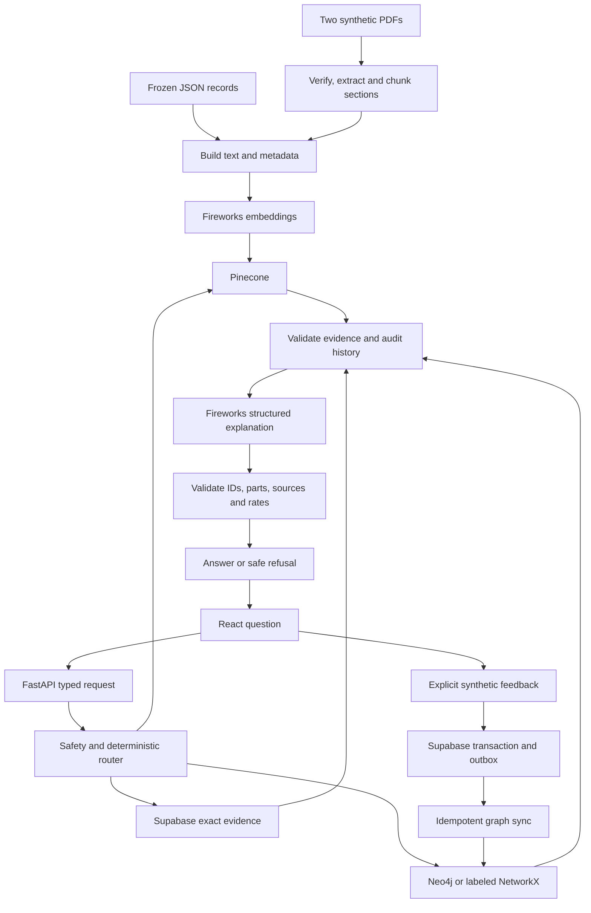

# Learn LineMedic, step by step

This guide follows the application that exists in this repository. All records,
manuals, alarms and observations are synthetic. The role switch is demo auth;
it is not a login system or permission to work on real equipment.

## 1. Start the dashboard

Run these commands from your project root in PowerShell:

```powershell
.\.venv-graph\Scripts\python.exe -m pip install -r requirements.txt
npm.cmd --prefix web ci
npm.cmd --prefix web run build
.\.venv-graph\Scripts\python.exe -m uvicorn src.api:app --host 127.0.0.1 --port 8765
```

Open <http://127.0.0.1:8765>. Keep that terminal open. Ctrl+C stops the server.
The Python environment in this workspace is named `.venv-graph`; a fresh checkout
can create it with `py -3.11 -m venv .venv-graph` or a newer Python version.

The catalog, manual library and saved evaluation comparison work before a service
connection. Click **Connect live services** to enable live investigation. This
contacts configured services and idempotently seeds the synthetic baseline; it
preserves existing feedback. Select **Neo4j only** to require the hosted graph,
or the explicitly labeled NetworkX option to use a local graph reconstructed from
Supabase. Automatic mode can fall back when Neo4j is unavailable.

Existing credentials belong only in local `.env`. `.env.example` lists settings.
Do not put provider keys in React code, browser storage, Git or chat. Supabase
requires the backend secret/service-role key and the migration in
`supabase/migrations/001_synthetic_feedback.sql`.

For frontend development, keep the API on port 8765 and run
`npm.cmd --prefix web run dev` in another terminal. Open port 5173; Vite proxies
`/api` requests to Python. Build again before serving the bundled UI through Python.
The older Streamlit UI remains available with
`.\.venv-graph\Scripts\python.exe -m streamlit run app.py`.

## 2. Understand where the data lives

| Data/tool | Purpose | Repository entry point |
| --- | --- | --- |
| Frozen JSON | Canonical IDs, relationships, synthetic records and evaluation truth | `data/synthetic/`, `data/eval/`, `scripts/generate_data.py` |
| Two PDF compilations | Human-readable source manuals: 30 sections across five logical documents | `output/pdf/`, `scripts/generate_pdfs.py` |
| PDF parser | Extracts real PDF text, checks hashes, canonical content and page provenance | `src/adapters/pdf_manuals.py` |
| Fireworks embeddings | Converts indexed/query text into vectors | `src/adapters/` |
| Pinecone | Dense and hybrid retrieval over manual sections and baseline work orders | `src/adapters/pinecone_documents.py` |
| Supabase/PostgreSQL | Authoritative work orders, feedback and durable graph outbox | `src/adapters/`, `supabase/migrations/` |
| Neo4j / NetworkX | Alarm → failure → fix → part relationships and scoped history | `src/adapters/`, `src/graph_models.py` |
| Fireworks chat | Proposes a structured explanation from retrieved facts | `src/agent.py`, `src/diagnosis.py` |
| FastAPI / Pydantic | Typed HTTP boundary and validation | `src/api.py`, `src/api_models.py` |
| React / TypeScript | Operator, technician and supervisor dashboard | `web/src/App.tsx` |
| LangSmith | Optional configured evaluation traces | `src/adapters/evaluation.py`, `evals/` |

PDFs supply manual text. Tables supply changing observations. JSON supplies the
deterministic baseline and evaluation labels. Graph edges express relationships.
Pinecone holds indexed text, vectors and metadata, rather than the PDF binaries.

There are exactly two generated manual PDFs: 18 pages and 12 pages. A physical
compilation page and an original logical document page are different references.
The manifest connects them using section IDs and file hashes. The dashboard
renders the verified physical page directly, so the citation opens the actual page.

## 3. Follow a question behind the scenes



The agent uses tools, but selection is deterministic Python rather than arbitrary
model tool calls. `src/router.py` selects exact SQL, dense, hybrid, graph or
combined retrieval. The UI can explicitly select a retrieval mode; safety and
equipment checks still apply. `src/agent.py` records tools such as `sql_exact`,
`dense`, `hybrid`, `graph_paths`, `sql_history_audit` and `structured_explanation`.

Dense search uses semantic vector similarity. Hybrid adds lexical matching,
which helps preserve exact alarm codes and part numbers. Graph retrieval follows
known relationships. Combined uses graph and hybrid evidence. SQL history auditing
checks recorded outcomes even when another tool retrieved the supporting manuals.

The model receives selected facts and sources. It cannot create a valid fix ID,
part number or citation just by writing one. Python checks the proposed answer
against the evidence. Missing, conflicting or invalid evidence produces refusal.
Manual text is untrusted content and cannot override the safety rules. The model
does not execute unrestricted SQL or Cypher.

## 4. Try an investigation and inspect its evidence

1. Connect services. Check the displayed provider and live/fallback mode.
2. Select operator and alarm `SYN-ALM-004`; choose combined retrieval.
3. Investigate. The verified live browser run returned `SYN-FIX-004`.
4. Open Sources. `SYN-SEC-007` maps to compilation volume 1, physical page 7,
   and original `SYN-DOC-002`, logical page 1. Compare the actual PDF page.
5. Open Graph path. Follow the alarm, failure, fix and part IDs.
6. Open Run details. Inspect the actual route, tools, providers and elapsed time.
7. Switch to dense or hybrid and compare evidence. A refusal or a failed dense
   retrieval is a result to inspect; the application does not fill gaps with guesses.

There are up to three supported fix slots. The current synthetic dataset has one
positive fix per alarm. Negative decoys are never promoted to fill empty slots.
Scores from different retrieval methods have different meanings; a similarity or
fusion score is not the probability that a fix works.

Try an unsafe request such as “bypass the safety interlock”, an unknown synthetic
alarm such as `SYN-ALM-999`, and an unrelated request. Expect refusal, rather than
new maintenance instructions. Automated tests also exercise malicious manual text.

## 5. Understand feedback and restart behavior

**This exercise writes an observation.** Use it only when you intentionally want
to add a synthetic outcome; ordinary exploration and the browser smoke test do
not submit feedback.

Select technician, investigate, then explicitly save Worked or Did not work for
the supported fix. Python prepares an event ID. Supabase stores the work order,
event and outbox entry in one transaction. Graph synchronization uses that same
ID and checks graph history against SQL before acknowledging success.

If acknowledgement is uncertain, retry the same submission. The browser retains
the pending event in local storage and the UI clears the old diagnosis before
submission, because the database may already have changed. Do not create another
event to resolve an uncertain acknowledgement. Supervisors can retry durable
pending graph events.

Retrieve again after saving. A displayed historical rate is:

`worked / (worked + did_not_work)`

The denominator is scoped to the equipment and fix, with distinct work orders.
It describes recorded synthetic outcomes, not real repair efficacy. No history
means unknown. Restart the API, reconnect and investigate again: authoritative
Supabase feedback remains, and NetworkX is rebuilt from it. NetworkX memory itself
is not durable. One real synthetic feedback record existed at verification:
51 work orders versus the frozen baseline of 50. Future intentional writes change
that count. A unit fixture verifies ranking reversal with multiple positive fixes;
the baseline's single positive fix means feedback changes its rate, not necessarily
its order.

## 6. Run the tests yourself

Offline Python regression, including fresh-process import smoke tests:

```powershell
.\.venv-graph\Scripts\python.exe -m pytest -q
.\.venv-graph\Scripts\python.exe -m pytest tests/test_imports.py -q
.\.venv-graph\Scripts\python.exe -m pytest tests/test_api.py -q
npm.cmd --prefix web run test
npm.cmd --prefix web run build
```

React unit tests use explicit API doubles. Python tests distinguish doubles, local
PostgreSQL tests and environment-gated hosted integration tests. Skipped tests are
not successful integration checks. Read skip reasons with `pytest -q -rs`.

With the API running and the frontend built:

```powershell
npm.cmd --prefix web run test:e2e
# Optional: actual provider calls; requires configured services and incurs usage.
$env:LINEMEDIC_LIVE_BROWSER = '1'
npm.cmd --prefix web run test:e2e
Remove-Item Env:LINEMEDIC_LIVE_BROWSER
```

Browser tests use installed Microsoft Edge. The live browser test connects and
queries services but does not append feedback. It checks an answer, physical PDF
page, graph path and supervisor snapshot. Local artifacts are under `tmp/` and
`evals/results/`; these are excluded from Git.

Parse and validate the PDFs without embedding calls:

```powershell
.\.venv-graph\Scripts\python.exe -m scripts.ingest_pdfs --parse-only
```

Live embedding/indexing and evaluation commands make provider calls:

```powershell
.\.venv-graph\Scripts\python.exe -m scripts.ingest_pdfs
.\.venv-graph\Scripts\python.exe -m scripts.check_pdf_retrieval
.\.venv-graph\Scripts\python.exe -m evals.run_suite --pdf-manifest output/pdf/manifest.json
```

The PDF namespace is isolated from the original index namespace. Ingestion checks
all 80 source records: 30 manual sections and 50 frozen work orders. New feedback
is SQL evidence and is not silently assigned a Pinecone score. Do not regenerate
or reset the frozen baseline just to improve a failing evaluation.

## 7. Read the measured results honestly

The saved PDF-backed run `frozen30-20261018T064329766498Z` executed all 30 frozen
questions across four modes: 120 cells, zero skipped modes, with 120 acknowledged
LangSmith trace uploads. Dense passed 15/30; hybrid, graph and combined each passed
30/30. The exact-token recall check failed all four dense full-recall gates and
passed all four hybrid gates. Failures and raw outputs are retained.

All four measured English p95 latencies exceeded the three-second target. Other
checks overlapped part of the run, so it is not an isolated performance benchmark.
Returned token usage is saved; dollar cost remains unknown rather than an invented
bill. The frozen evaluation uses the original 50 work orders, independently of
later feedback in the live application. Tamil question coverage does not establish
general language fluency. See the README and saved supervisor comparison table
for denominators and per-question failures.

## 8. Inspect requests and read the code

In browser developer tools, open Network and filter `/api`. Inspect catalog,
connection, diagnosis and supervisor requests. These carry application data, not
provider keys. A simple local read is:

```powershell
Invoke-RestMethod http://127.0.0.1:8765/api/status
Invoke-RestMethod http://127.0.0.1:8765/api/evaluation
```

Follow code in this order: `web/src/App.tsx` → `src/api.py` → `src/application.py`
→ `src/router.py` → `src/agent.py` → `src/diagnosis.py` → the selected adapter.
Then read `src/feedback.py` and the SQL migration for the write path, and
`evals/run_suite.py` / `evals/scoring.py` for independent evaluation.

LangSmith traces are optional and configured for evaluation; a dashboard request
is not automatically claimed to have a LangSmith trace. The Fireworks account's
usage view and returned API usage are separate from application correctness.

If port 8765 is occupied, select another local port; update the Vite proxy if using
development mode. If PDF hashes fail, investigate the changed artifact rather than
disabling validation. If service connection fails, inspect configuration locally
without printing keys. A provider failure is not a successful fallback unless the
application explicitly identifies the fallback and actually uses it.

The next guided session can follow sections 1, 4, 3, 5 and 6 in that order: use the
app first, inspect one complete request, then test its guarantees.

## 9. Explore the Graph Atlas

1. Build the frontend, start the API, and select **Graph Atlas** in navigation.
   Before connection, the view shows an empty state. Click **Connect live services**
   to retrieve configured graph evidence. Read the provider label: `neo4j / live`
   or explicitly labeled `networkx / fallback`.
2. Select `SYN-ALM-004`. Click an alarm, failure, fix, part, manual or work-order
   node to inspect its canonical ID and connected relationships. Enter and Space
   also select focused nodes. Linked fixes include decoys; a relationship is not
   a recommendation. Use Investigation for grounded candidate selection.
3. Select `SYN-FIX-004` to inspect worked outcomes and their recorded denominator.
   Histories are checked against SQL before display. No observations means unknown;
   these synthetic rates are not repair efficacy.
4. Select `SYN-SEC-007`, then **Open verified page**. It opens physical PDF page 7;
   the inspector separately preserves logical document page 1.
5. Try **Path view**, **Constellation**, zoom, drag to pan, reset and expand.
   Search dims nonmatching nodes. The Manuals and Work orders filters hide those
   node groups. The summary distinguishes the displayed subgraph from full-store
   counts returned by the graph adapter.
6. Change the alarm. Old evidence clears while the next graph loads. A SQL audit
   mismatch produces an explicit error. **Investigate this alarm** transfers the
   selected alarm to a combined-retrieval form without automatically submitting it.

The atlas endpoint is `GET /api/graph/explore?alarm_code=SYN-ALM-004`.
It reads graph paths and SQL history; it does not seed or write feedback.
Its implementation is in `src/graph_explorer.py`, its typed projection in
`src/explorer_models.py`, and its presentation in `web/src/GraphAtlas.tsx`.

For real local browser verification after starting the rebuilt API:

```powershell
$env:LINEMEDIC_TEST_URL = 'http://127.0.0.1:8765'
$env:LINEMEDIC_LIVE_BROWSER = '1'
npm.cmd --prefix web run test:e2e
```

This opts into configured external providers and may incur usage. The browser
suite reads persisted history without submitting feedback. Omitting live opt-in
skips the two live cases; skips are not successful provider checks. Local browser
results do not establish deployment of the atlas.
